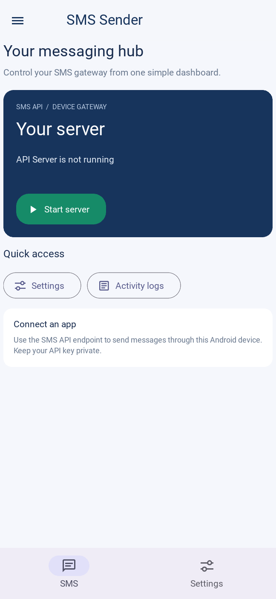
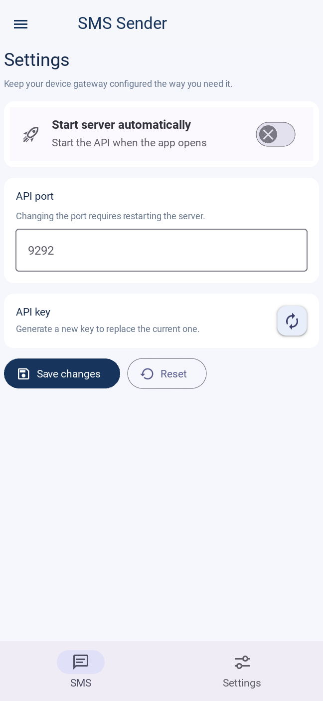
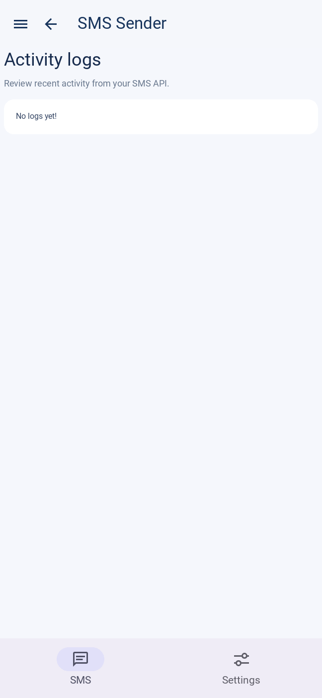

# SMS Sender for Ethiopia

SMS Sender for Ethiopia is the Ethiopia-focused version of OpenSMS maintained in [this fork](https://github.com/nataniumcs9-web/OpenSMS). It turns a compatible Android phone and SIM into a locally controlled SMS gateway. An authenticated API client can request a text message; the Android device sends it using its SIM and Android SMS permission.

The app is designed for Ethiopian Android users, including use with Ethiopian phone numbers in `+251` international format. It is intended to send through a compatible Ethiopian SIM when the device, Android version, carrier service, and permissions support SMS. Testing with Ethiopian devices and carriers is still needed before claiming it works reliably across networks. Delivery, charges, and sender identity depend on the SIM, carrier, and device.

## App screenshots

| Splash screen | SMS dashboard |
| --- | --- |
|  |  |

| Settings | Activity logs |
| --- | --- |
|  |  |

## Current features

- Android app for starting and stopping the SMS API service.
- API-key protected `POST /sms/` endpoint.
- Configurable API port and optional server auto-start.
- Activity logs for API requests.

Contacts, contact groups, sender-name configuration, bulk campaigns, and a web management dashboard are not implemented yet.

## Run the Android app

Download an Android release from [this fork's releases page](https://github.com/nataniumcs9-web/OpenSMS/releases) when one is published. Install it on a compatible Android phone, grant its requested permissions, open the app, and start the server. On first use, generate an API key and store it securely.

## Send a test SMS through the API

Find the phone's local network address, keep the phone and API client on a trusted network, and replace the example API key and phone number:

```bash
curl -i -X POST 'http://127.0.0.1:9292/sms/' \
    -H 'Content-Type: application/json' \
    -H 'Authorization: Bearer YOUR_API_KEY' \
    -d '{"number": "+2519XXXXXXXX", "text": "Hello from SMS Sender for Ethiopia!"}'
```

Use an international-format number with Ethiopia's `+251` country code for an Ethiopian destination. The API currently accepts a phone number and message text; it does not manage contacts, groups, campaigns, or custom sender names.

## Build from source

The Android APK build is intended for Linux. On Windows, use WSL or a Linux virtual machine. Install the Android build dependencies described in [Buildozer's documentation](https://buildozer.readthedocs.io/), then:

```bash
git clone https://github.com/nataniumcs9-web/OpenSMS.git
cd OpenSMS/app
python3 -m venv .venv
source .venv/bin/activate
pip install -r req_android.txt
buildozer android debug
```

The existing API and SMS behavior is based on [daslearning-org/OpenSMS](https://github.com/daslearning-org/OpenSMS). The original [Apache License 2.0](LICENSE) and upstream attribution are retained.

## Roadmap: build the SMS management system

The next major product goal is to build a management system for Ethiopian SMS workflows. The phased plan covers local phone-number conventions, contact and group management, message composition, consent and opt-out handling, campaign controls, an optional web dashboard, and testing with Ethiopian devices and carrier SIMs.

See the [SMS management system roadmap](docs/management-roadmap.md) for proposed phases and decisions to settle before implementation. These are planned features, not current functionality.
